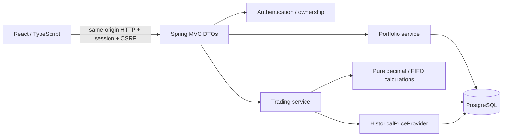

# Architecture

AEGIS is an educational investment simulator, delivered as a modular Java application and a React client. Phase 1 established accounting and traceability; Phase 2 adds historical valuation and simple performance; Phase 3 layers historical risk and read-only stress repricing on that foundation.

## Boundaries

| Package | Responsibility |
| --- | --- |
| `auth` | BCrypt credentials, session establishment, CSRF/security policy, current user lookup |
| `portfolio` | Ownership, funding, consistent holdings/cash snapshot, append-only ledger/audit persistence |
| `market` | Synthetic data generation/loading, exact-date quote access, historical-price interface |
| `analytics` | Pure historical valuation, bounded execution/price reads, owner-scoped valuation/performance APIs |
| `risk` | Pure aligned-return/volatility/VaR/drawdown/stress engine and bounded owner-scoped read APIs |
| `trading` | Transaction orchestration, idempotency, chronological orders, FIFO position lots; pure `FinancialMath` |
| `operations` | Safe request/transaction telemetry, owner-scoped reconciliation and separate migration-only command |
| `shared` | Protocol-independent business failures |
| `web` | Common errors, pagination, exact decimal JSON serialization, OpenAPI configuration |

Controllers validate/translate HTTP input, resolve the user, and delegate. Services coordinate business operations; repositories handle persistence. DTOs avoid exposing password hashes, entity relationships, and Hibernate state. `FinancialMath` has no Spring or database dependency; it uses a domain exception for explicit failures. Modules share a deployment/database, not a message bus. Spring Data JPA owns mutable aggregates and order entities; JDBC handles set-based holdings reads, market data and append-only records where entity lifecycle adds little value. Both participate in the same Spring-managed database transaction.

## Trade transaction

1. Resolve the authenticated owner; acquire `SELECT ... FOR UPDATE` on that owner's portfolio.
2. Check the portfolio-scoped idempotency key. Replay an identical semantic payload, or return 409 for different input.
3. Enforce nondecreasing historical execution dates, exact-date positive close and positive settled USD value.
4. Check cash or compute FIFO sell allocations. No short sales, borrowing, or unsettled money.
5. Insert the execution, create/consume lots, update cash, append ledger and audit records in one transaction.
6. Commit all changes, or roll back all changes. The server returns the stored execution for later retries.

PostgreSQL READ COMMITTED plus a pessimistic portfolio lock serializes all mutations for one portfolio, including concurrent buys, sells and duplicate keys. Different portfolios can proceed independently. The database uniqueness constraint on `(portfolio_id, idempotency_key)` is a second defense. The service transaction timeout is 15 seconds; there is no automatic retry that could create a new trade. Clients must reuse the key after uncertain responses. No lock is held while calling an external price API; Phase 1 prices are local.

Cash plus holdings is read in one REPEATABLE READ transaction so a response cannot combine pre-trade cash with post-trade lots. Histories are paginated with a stable secondary UUID sort. Separate requests can observe different committed moments; live cross-panel snapshot synchronization is not claimed.

## Authentication and deployment boundary

Spring Security uses server-side sessions, a 30-minute inactivity timeout, session-ID rotation at login and BCrypt cost 12. The authentication cookie is HttpOnly, SameSite=Strict, and Secure when `COOKIE_SECURE=true`. Tokens are never put in localStorage. CSRF protection remains enabled for register, login, logout and trading. The readable XSRF cookie/token is only a CSRF defense, not an authentication credential. The client refreshes its CSRF token after authentication/logout. API resource ownership is enforced in database queries; a foreign portfolio returns 404 to avoid revealing its existence. Same-origin routing avoids permissive CORS.

Nginx serves the built UI and proxies `/api` to the backend in Docker. Local development uses the Vite proxy. PostgreSQL persists through a named volume. Backend/frontend processes run without root. Health is exposed without database details, and application logs use JSON without passwords or full request bodies. A processed-order log is not a commit receipt; the durable audit row is authoritative.

This is a local development baseline, not a production deployment. Sessions live in one JVM and disappear on restart. Phase 4 adds persistent abuse budgets, tested migration/runtime role separation and disposable backup/restore drills. Public TLS termination, password recovery/verification, shared sessions, offsite/PITR backup operations and comprehensive monitoring remain deployment work. Database admins can alter triggers; append-only protection is not cryptographic tamper resistance. Do not expose the local HTTP stack publicly.

## Why these choices

A single transaction boundary is the simplest way to preserve accounting consistency. Fixed-scale decimal persistence and pure FIFO functions make results explainable and testable. Historical simulation has an explicit clock separate from the actual recording clock. Keeping performance/risk out of Phase 1 avoids presenting calculations before their assumptions and tests exist. See [DECISIONS.md](DECISIONS.md) and [the phase plan](docs/PLAN.md).

## Phase 2 historical read model

`AnalyticsController` validates HTTP date shapes and resolves the user. `AnalyticsService` verifies ownership before date/domain checks and runs each response in a **read-only REPEATABLE READ transaction** with a 15-second timeout. The combined `/performance` response includes ending summary, endpoint change/return, series and allocation in one consistent snapshot; separate endpoint requests can naturally observe different later committed trades.

`AnalyticsRepository` reads one initial funding row, at most 10,001 dated executions (the extra row detects the 10,000 cap), and one bulk exact-date price set. Sell costs are indexed sums of immutable sell allocations, checked against stored realized P/L. Asset/date uniqueness and limits of 100 symbols × 1,461 days bound price results to at most 146,100 rows. V2 adds `(portfolio_id, price_date, recorded_at, id)` and `sell_allocation(sell_order_id)` indexes for these actual query patterns. There is no query per chart point or per displayed asset.

`ValuationEngine` is independent of Spring, HTTP and persistence. It sorts immutable accounting events by effective date, advances cash/quantity/cost/realized balances once through history, and marks each date's positions using exact closes. Complexity is O(orders log orders + days × assets), bounded before computation. Daily DTOs omit per-position arrays to keep responses compact; the ending snapshot contains position detail. No cache/precomputed mutable snapshot is needed at this scale, so new trades cannot leave cached financial results stale.

The engine never consults current mutable lot balances for past values. FIFO allocations already encode which purchase costs were consumed. End-of-day sums are independent of ordering among same-date records, including tied recording timestamps. It verifies nonnegative reconstructed resources and `realized + unrealized = equity − initial capital` rather than returning plausible but inconsistent totals.

The persisted simulation start is 2022-01-03. Opening funding belongs to this synthetic clock; actual creation and ledger timestamps are not rewritten. V2 is additive, and a V1-to-V2 PostgreSQL test preserves existing orders/funding/cash/cost. A local pre-upgrade backup was also restored separately and every original row hash compared, excluding only the newly added baseline column. Database backups remain outside Git and are not a replacement for production backup/recovery operations.

The UI fetches the combined endpoint with cancellation guards so late responses cannot overwrite a different selected range/portfolio. Monetary values remain server decimal strings; chart coordinate/formatting conversion uses Number only for presentation. Recharts is lazy-loaded separately (not on the login path). The equity line preserves null gaps; a distinct dashed line shows the initial capital. Keyboard interaction, explicit tooltips and a paginated dated-data table provide alternatives to reading SVG alone. Allocation includes cash and has a visible value/weight list. The lower Phase 1 execution desk is labeled as the latest executed state, distinct from historical analytics above it.

This is a simple one-deposit wealth-return model, not TWR/MWR or a bitemporal audit-reporting system. Missing closes make affected totals unknown; a cash-only day is valid without prices. Longer-series downsampling, incremental materialization, multi-flow returns and correlation/variance attribution are intentionally deferred. See FINANCIAL_ASSUMPTIONS.md for the complete policies.

## Phase 3 risk read model

`RiskController` reuses session authentication, `CurrentUser`, CSRF and existing domain error conventions. `RiskService` verifies ownership before date/window/scenario domain handling, then uses a read-only REPEATABLE READ transaction with 15s timeout. The summary loads bounded immutable executions, funding and one bulk price set through the requested date. It calls the unchanged `ValuationEngine` once for the selected window and passes its ending snapshot to the separate pure `RiskEngine`. No current mutable lots enter historical calculations, and no schema migration is necessary.

The summary combines exposures, historical shock observations, volatility, VaR and actual equity drawdown in one snapshot. Dedicated returns/drawdown endpoints expose the same results. Stress loads one selected-date valuation and calculates at most eight scenarios over those quantities. POST computation remains CSRF protected; there are no persistence writes or audit events. PostgreSQL tests compare full financial-row JSON before/after successful and rejected stress requests.

For T executions, D calendar days, A symbols and N aligned shocks, time is O(T log T + D×A + N log N), memory O(T + D×A + N). Actual queries: owner lookup, bounded executions (≤10001 rows to detect the 10000 cap), funding and one bulk price query; no query per day, asset or scenario. At most 100 symbols × 1461 days bounds prices to 146100 rows; actual synthetic history has 1043 closes per asset / 1042 full-window return pairs. A summary response contains at most 1043 shock records under the conservative weekday bound, with up to 100 returns per record. Missing symbol/date diagnostics are also bounded by the price rectangle. Dedicated endpoints intentionally reuse the same bounded calculation; there is no mutable cache or separate infrastructure.

The React Risk Lab preserves the original dark palette, keeps performance/trading accessible, and renders only real API values. Chart numbers/bin counts are presentation transforms of backend observations. Financial sums/percentages come from Java decimal calculations. Requests use cancellation guards; changing analysis removes prior output while loading, and stress sliders debounce 250ms with stale-response protection. Charts include keyboard layers and exact data tables; controls, focus tooltips, responsive grids and scrollable tables support desktop/mobile journeys. Saved custom comparisons are session component state, reset when analysis/portfolio changes; no scenario persistence is claimed.

See [risk specification](docs/PHASE3_RISK_SPEC.md) for the strict missing-weekday and sample policies. See [security scan evidence](docs/PHASE3_SECURITY.md) for compatible dependency fixes and remaining Spring MVC advisory limitations; the earlier Phase 3 findings are resolved and expanded in [PHASE4_SECURITY_REVIEW.md](docs/PHASE4_SECURITY_REVIEW.md).

## Phase 4 engineering controls

The supported Boot 4.0.8 / Framework 7.0.9 platform replaces the prior vulnerable MVC dependency. Springdoc 3, Jackson 3 module imports and Testcontainers 2 follow the official migration path; exact decimal serialization and every financial fixture remain unchanged. Same-line Jackson/Tomcat maintenance overrides address newly detected transitive advisories. No financial engine or dashboard redesign was required.

`AttemptLimiter` uses atomic PostgreSQL UPSERTs with expiry timestamps and indexed, bounded cleanup. It stores hashes of account/client identities, not plaintext credentials or raw identities, and survives JVM restarts. Fixed windows deliberately impose temporary account limits rather than permanent locks. CSRF precedes authentication admission; parser/body caps precede MVC. Client identity uses the network peer, with no trust in arbitrary forwarded headers. Shared proxy/NAT budgets and distributed abuse limitations are documented.

Security uses two chains: normal session/CSRF/ownership for application APIs, and stateless separately credentialed OPS access for read-only Actuator metrics, with minimal public health probes. A normal account cannot become OPS. Request filters produce server-generated correlation IDs, bounded-route timing/count metrics and safe problem references. Transaction synchronizations publish commit/replay/rejection/rollback only after completion. Application/proxy access logs omit bodies, raw queries, cookies, credentials and identities; raw SQL error details are disabled.

The browser's sessionStorage journal is saved before POST, scoped to a portfolio, and freezes ambiguous input. Startup performs owner-scoped key lookup; replay always reuses the exact saved intent. It survives refresh and reauthentication after a server restart, while closing/clearing tab storage remains a manual recovery boundary. PostgreSQL locks and semantic idempotency validation remain the authoritative duplicate protection, not browser storage. The new read-only reconciliation service compares mutable cash/lots with immutable executions, allocations, ledger and audit relationships; it never repairs data.

V3 adds only expiring authentication counters. An explicit `--migrate-only` entry path runs migrations/seeding and exits without HTTP/JPA. The optional runtime role profile disables runtime migration/seeding and grants only required reads/inserts and mutable-column updates; Hibernate dirty-column writes support those grants. Default local Compose compatibility is retained, with its owner-privilege limitation clearly documented. Database ownership remains powerful; this is not RLS or tamper-proof history. Disposable tests execute real grants, V2→V3 preservation, custom dump/restore, refusal of destructive targets and ordered financial row fingerprints.

Runtime images are pinned to inspected digests and run non-root with no capabilities, no-new-privileges, read-only filesystems and bounded temporary storage/process counts. Graceful shutdown, bounded connection acquisition and readiness/liveness probes improve restart behavior using the existing JVM/PostgreSQL deployment. The benchmark harness measures actual serial in-process HTTP/SQL/JSON operations on isolated synthetic inputs; observed timings did not justify caches/new services or financial-algorithm changes. See [runbook](docs/PHASE4_OPERATIONS.md), [security review](docs/PHASE4_SECURITY_REVIEW.md) and [measured scope](docs/PHASE4_BENCHMARKS.md). Stop before Phase 5.

## Phase 5 deployment preparation

`compose.deployment.yml` is independent of the development stack. It has one private API instance, non-owner serving credentials, short-lived migration/grant processes and one same-origin HTTPS Nginx edge. An exact private edge address asserts a single client IPv4 after stripping external forwarding headers; the API never generally trusts X-Forwarded-For. Sessions remain process-local; restart/rollback requires sign-in while the same saved order intent/key can recover a committed response.

Deployment validation and startup fail closed on unsafe settings/effective database roles. Runtime image identities and OCI/report/SBOM checksums are validated against the source commit and ≤48h vulnerability/Java databases. PostgreSQL explicitly initializes non-root with writable data/root directories; it is not claimed read-only. These checks, encrypted new-database restoration, real proxy clients, DB outage probes and immutable-artifact rollback have separate local evidence. Financial calculations and immutable records are unchanged. Host/domain/off-host storage/operator inputs are absent: [release remains blocked](docs/PHASE5_RELEASE.md), with no public deployment claim.
