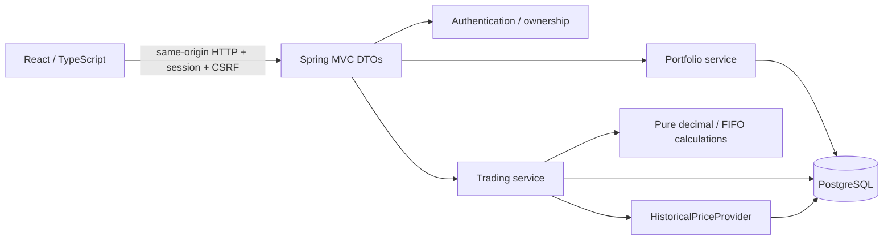

# Architecture

AEGIS is an educational investment simulator, delivered as a modular Java application and a React client. Phase 1 deliberately concentrates on accounting and traceability before analytics.

## Boundaries

| Package | Responsibility |
| --- | --- |
| `auth` | BCrypt credentials, session establishment, CSRF/security policy, current user lookup |
| `portfolio` | Ownership, funding, consistent holdings/cash snapshot, append-only ledger/audit persistence |
| `market` | Synthetic data generation/loading, exact-date quote access, historical-price interface |
| `trading` | Transaction orchestration, idempotency, chronological orders, FIFO position lots; pure `FinancialMath` |
| `shared` | Protocol-independent business failures |
| `web` | Common errors, pagination, exact decimal JSON serialization, OpenAPI configuration |

Controllers validate/translate HTTP input, resolve the user, and delegate. Services coordinate business operations; repositories handle persistence. DTOs avoid exposing password hashes, entity relationships, and Hibernate state. `FinancialMath` has no Spring or database dependency; it uses a domain exception for explicit failures. Modules share a deployment/database, not a message bus. Spring Data JPA owns mutable aggregates and order entities; JDBC handles set-based holdings reads, market data and append-only records where entity lifecycle adds little value. Both participate in the same Spring-managed database transaction.

## Trade transaction

1. Resolve the authenticated owner; acquire `SELECT ... FOR UPDATE` on that owner's portfolio.
2. Check the portfolio-scoped idempotency key. Replay an identical semantic payload, or return 409 for different input.
3. Enforce nondecreasing historical execution dates, exact-date positive close and positive settled USD value.
4. Check cash or compute FIFO sell allocations. No short sales, borrowing, or unsettled money.
5. Insert the execution, create/consume lots, update cash, append ledger and audit records in one transaction.
6. Commit all changes, or roll back all changes. The server returns the stored execution for later retries.

PostgreSQL READ COMMITTED plus a pessimistic portfolio lock serializes all mutations for one portfolio, including concurrent buys, sells and duplicate keys. Different portfolios can proceed independently. The database uniqueness constraint on `(portfolio_id, idempotency_key)` is a second defense. The service transaction timeout is 15 seconds; there is no automatic retry that could create a new trade. Clients must reuse the key after uncertain responses. No lock is held while calling an external price API; Phase 1 prices are local.

Cash plus holdings is read in one REPEATABLE READ transaction so a response cannot combine pre-trade cash with post-trade lots. Histories are paginated with a stable secondary UUID sort. Separate requests can observe different committed moments; live cross-panel snapshot synchronization is not claimed.

## Authentication and deployment boundary

Spring Security uses server-side sessions, a 30-minute inactivity timeout, session-ID rotation at login and BCrypt cost 12. The authentication cookie is HttpOnly, SameSite=Strict, and Secure when `COOKIE_SECURE=true`. Tokens are never put in localStorage. CSRF protection remains enabled for register, login, logout and trading. The readable XSRF cookie/token is only a CSRF defense, not an authentication credential. The client refreshes its CSRF token after authentication/logout. API resource ownership is enforced in database queries; a foreign portfolio returns 404 to avoid revealing its existence. Same-origin routing avoids permissive CORS.

Nginx serves the built UI and proxies `/api` to the backend in Docker. Local development uses the Vite proxy. PostgreSQL persists through a named volume. Backend/frontend processes run without root. Health is exposed without database details, and application logs use JSON without passwords or full request bodies. A processed-order log is not a commit receipt; the durable audit row is authoritative.

This is a local development baseline, not a production deployment. Sessions live in one JVM and disappear on restart. TLS termination, rate limiting, password recovery/verification, session-store scaling, backup/restore drills, dedicated migration/runtime DB roles, and comprehensive security monitoring are later work. Database admins can alter triggers; append-only protection is not cryptographic tamper resistance. Do not expose the local HTTP stack publicly.

## Why these choices

A single transaction boundary is the simplest way to preserve accounting consistency. Fixed-scale decimal persistence and pure FIFO functions make results explainable and testable. Historical simulation has an explicit clock separate from the actual recording clock. Keeping performance/risk out of Phase 1 avoids presenting calculations before their assumptions and tests exist. See [DECISIONS.md](DECISIONS.md) and [the phase plan](docs/PLAN.md).
