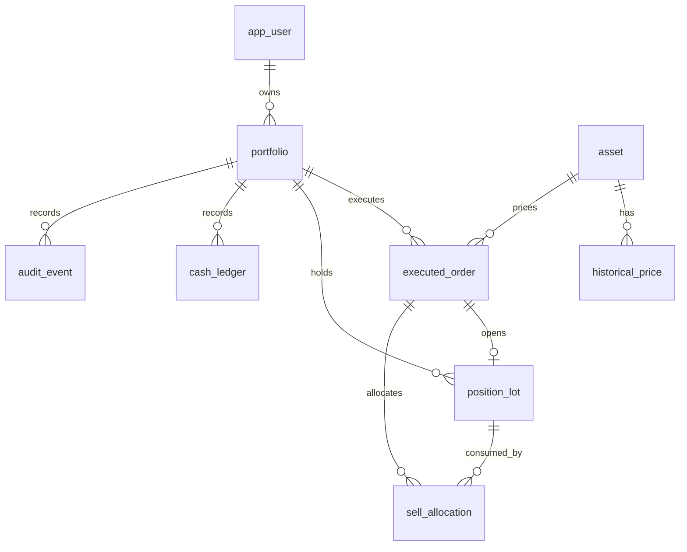

# Data model

All IDs are UUIDs except generated historical-price IDs and lot ordering sequences. All timestamps are UTC PostgreSQL `timestamptz`. Flyway owns schema evolution; Hibernate validates rather than creates tables.

| Table | Relationships and role |
| --- | --- |
| `app_user` | Unique normalized email, BCrypt password hash, creation timestamp |
| `asset` | Fictional symbol, name, sector, USD currency, synthetic dataset version |
| `historical_price` | Asset FK; unique `(asset_symbol, price_date)`; strictly positive `numeric(19,4)` close |
| `portfolio` | Owner FK; USD; nonnegative `numeric(19,2)` cached cash; last historical trade date |
| `executed_order` | Portfolio and asset FKs; immutable execution, quantity `numeric(19,6)`, price, gross, realized P/L, two timestamps, idempotency key |
| `position_lot` | One buy order FK; original/remaining quantities and remaining settled cost; historical acquisition timestamp, generated sequence |
| `sell_allocation` | Sell order and lot FKs; immutable consumed quantity and allocated cost |
| `cash_ledger` | Portfolio FK, optional unique order FK, signed amount, balance after, recording timestamp |
| `audit_event` | Portfolio/actor FKs; immutable event type, referenced portfolio/order UUID, recording timestamp |

## Invariants

- The HTTP create command allows an initial deposit from USD 0.01 to USD 1 billion, with no more than two decimals. It creates the portfolio, one funding ledger entry and its audit event atomically. An index allows at most one funding row per portfolio. Additional deposits/withdrawals are not implemented.
- Portfolio currency and asset currency are constrained to USD. There is no implicit FX conversion.
- Cash never goes negative. The sum of signed ledger amounts equals cached cash after every successful service operation. `balance_after` records each result. Reconciliation is tested; an ongoing reconciliation job is future work.
- Each successful order has one cash-ledger row. BUY amount is negative, SELL positive. Quantities and execution prices are positive; gross rounds to at least one cent.
- A lot's remaining quantity stays within `[0, original_quantity]`; a fully consumed lot has zero remaining cost. A lot's remaining cost can be zero after rounding a tiny partial remainder.
- FIFO sorting uses historical acquisition time then generated insertion sequence. Same-date buys have an unambiguous order even when recording timestamps tie.
- `(portfolio_id, idempotency_key)` is unique for the lifetime of the portfolio. Failed requests do not reserve a key. Request equivalence compares symbol, side, decimal quantity by numeric value, and price date.
- Orders, ledger, allocations and audit events have triggers rejecting UPDATE and DELETE. There is no delete-portfolio or edit-history API.
- The portfolio lock protects all lot/cash changes. The database does not independently compute FIFO or cross-row ledger reconciliation; direct SQL writes bypass service invariants and are outside the application API boundary.

## Index/query rationale

Owner + creation time supports the portfolio picker. Portfolio + descending recorded time supports paginated executions, ledger and audit history. Portfolio + asset + historical acquisition time + sequence (partial index for open lots) supports FIFO consumption. Unique asset/date supplies quote lookups. Orders' idempotency uniqueness supplies replay lookup. Foreign keys do not cascade away accounting history.

## ER overview

## V2 — simulation baseline and analytics reads

`portfolio.simulation_start_date` is a nonnull date defaulting to 2022-01-03, backfilled for all existing rows and immutable through the application. It does not change actual `created_at` or any funding/execution/ledger timestamps. Funding is interpreted as available at that simulated day's opening. No financial history or balances are rewritten.

The historical read model reconstructs cash/quantity/cost using executed orders and immutable sell allocations through the selected date. `order_portfolio_historical(portfolio_id, price_date, recorded_at, id)` supports bounded effective-date reads; `allocation_sell_order(sell_order_id)` supports per-execution immutable cost sums. Existing unique asset/date indexing supplies bulk marks. No valuation table or duplicated mutable financial snapshot is added. Tests upgrade an actual V1 fixture to V2 and verify preserved state and a correct reconstructed valuation.
