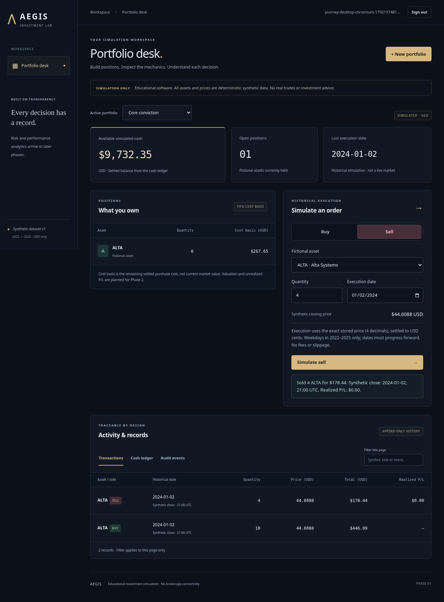

# AEGIS

**Financial Risk & Trading Analytics Platform — Phase 1**

AEGIS is an educational investment simulator built with Java 21, Spring Boot 3.5, PostgreSQL and React/TypeScript. Its first release focuses on the accounting behind a portfolio: exact decimal settlement, transaction safety, FIFO cost basis and explainable records.

**Simulation only.** All default assets and prices are deterministic synthetic data. No brokerage integration, real trades or investment advice. The project is not an institution-grade financial risk system.

## Implemented

- Registration/login with BCrypt, HttpOnly session cookies, CSRF protection and portfolio ownership checks.
- Named USD portfolios, one initial simulated cash deposit and immutable funding records.
- ALTA, BRIM and COVE: fictional assets with 3,129 fixed-seed weekday closes spanning 2022–2025.
- Historical-close buys/sells with exact decimal quantities, insufficient-cash/oversell rejection, chronological dates and portfolio-scoped idempotency.
- FIFO holdings/cost basis, realized sell P/L, transaction history, cash ledger and audit events.
- Responsive dark dashboard, record filtering/pagination, explicit loading/empty/error states and simulation labels.
- Flyway migrations, authenticated OpenAPI JSON, health checks, JSON logs, PostgreSQL integration tests and desktop/mobile browser journeys.

**Not implemented:** valuation time series, unrealized P/L, returns, charts, volatility, drawdown, VaR, stress testing, external market data, FX or production deployment. Those begin in later phases; there are no placeholder risk metrics. See [PROGRESS.md](PROGRESS.md).

## Run locally

Requires Docker with Compose v2. The optional helper scripts use Bash and standard Unix utilities; application components use Java and TypeScript.

```bash
./scripts/init-local.sh
# Alternatively copy .env.example to .env and choose a unique local DB password.
docker compose up --build -d
```

The UI uses local port **5173**; the API/health endpoint uses **8080**; PostgreSQL uses **5432**. Ports bind to loopback. Register your own account; no shared/demo password is built in. Confirm backend startup with:

```bash
./scripts/wait-ready.sh
# Or inspect the backend directly:
curl --fail http://localhost:8080/actuator/health
```

The first startup applies Flyway and loads synthetic data. The database lives in a named volume. `docker compose down` stops services while retaining data. Do not remove the volume unless you intentionally want to erase local accounts/portfolios. The local HTTP configuration is for development; HTTPS and `COOKIE_SECURE=true` are required before deployment. Read [ARCHITECTURE.md](ARCHITECTURE.md) for remaining security/operational work.

### Develop with local Java and Node

Requires a **full JDK 21**, Maven 3.9+, Node 24/npm and Docker for PostgreSQL/Testcontainers.

```bash
./scripts/init-local.sh
docker compose up -d --wait db
mvn -B -ntp -f backend/pom.xml verify
npm --prefix frontend ci
npm --prefix frontend run build
./scripts/start-backend.sh
# In a second terminal:
npm --prefix frontend run dev
```

`start-backend.sh` reads your trusted local `.env` and launches the packaged application. Environment variables: `DATABASE_URL` (default `jdbc:postgresql://localhost:5432/aegis`), `DATABASE_USERNAME` (default `aegis`), required `DATABASE_PASSWORD`, and `COOKIE_SECURE` (default false for local HTTP). Never commit credentials. Vite proxies `/api` to port 8080; optional `API_PROXY_TARGET` changes that development target.

In the prepared cloud workspace, use `./scripts/cloud-maven.sh -B -ntp verify` in place of `mvn`. It activates the verified full JDK/Maven, a writable cache and the existing egress proxy/system trust store without disabling TLS checks. This helper is optional and not required by standard local development or CI.

### First simulated journey

1. Register with your own email and a 12–72 character password (at most 72 UTF-8 bytes).
2. Create “Core conviction” with USD 10,000 of simulated cash.
3. Choose ALTA, quantity 10 and historical execution date 2024-01-02; inspect the exact synthetic close, then buy.
4. Sell 4 units on the same date. Review the remaining 6 units and FIFO cost basis, executed records, ledger and audit trail.
5. Try overselling or choosing a Saturday. The application rejects the order or shows the missing quote explicitly.

Funding is available before the first simulated order. Trade dates can stay the same or move forward; they cannot move backwards. Synthetic 21:00 UTC close timestamps do not represent real exchange executions. See [FINANCIAL_ASSUMPTIONS.md](FINANCIAL_ASSUMPTIONS.md) for all conventions and omissions.

### Packaging in a restricted cloud network

Build containers may lack the cloud host's package proxy/DNS/trust configuration. A source-image build was blocked here by Maven DNS resolution. The verified alternative packages the same locally tested artifacts into nonroot runtime images:

```bash
./scripts/cloud-maven.sh -B -ntp verify
npm --prefix frontend ci
npm --prefix frontend run build
BUILDX_CONFIG=/workspace/.cache/buildx docker compose -f compose.yml -f compose.prebuilt.yml up --build -d
```

Stop local Java/Vite processes first if they occupy ports 8080/5173. This path preserves TLS verification for dependency downloads and avoids downloading dependencies inside image builds. Rebuild artifacts before repackaging after code changes. Standard local source-image builds remain available in compose.yml; their success in this restricted environment is not claimed.

## Screenshots

Captured from the running application using only the fixed-seed synthetic dataset and automated browser-created simulated trades:



[Mobile screenshot](docs/images/phase1-mobile.png)

## Verify

```bash
mvn -B -ntp -f backend/pom.xml verify
npm --prefix frontend run build
npm --prefix frontend run format:check
npm --prefix frontend audit
# With API, database and UI running:
cd frontend
npx playwright install --with-deps chromium
npm run test:e2e
```

The backend test suite requires Docker and starts an isolated PostgreSQL database; it never silently skips database tests. E2E tests register isolated users against the running development stack. A system browser can be selected with `PLAYWRIGHT_CHROMIUM_EXECUTABLE_PATH=/usr/bin/chromium` when managed-browser downloads are unavailable. [TESTING.md](TESTING.md) records executed results and verification limits.

## Engineering guide

| Document | Content |
| --- | --- |
| [Architecture](ARCHITECTURE.md) | Modules, transaction flow, authentication, deployment boundaries |
| [Data model](DATA_MODEL.md) | Tables, relations, constraints and query-driven indexes |
| [API](API.md) | Session/CSRF flow, endpoint contracts and retry semantics |
| [Financial assumptions](FINANCIAL_ASSUMPTIONS.md) | Rounding, FIFO formulas, synthetic data, missing prices, omissions |
| [Decisions](DECISIONS.md) | Important choices and alternatives |
| [Testing](TESTING.md) | Commands, evidence and scope |
| [Progress](PROGRESS.md) | Delivered and unfinished functionality |
| [Cloud environment rebuild](docs/CLOUD_ENVIRONMENT.md) | Saved Codex installation/startup instructions and state boundaries |
| [Phase plan](docs/PLAN.md) | Explicit acceptance criteria for Phases 0–5 |
| [Mentoring notes](docs/MENTORING.md) | Phase explanations and ten interview questions with sample answers |

The repository deliberately stops at Phase 1. Performance and risk analytics require their own mathematical specifications and deterministic test fixtures before implementation.
