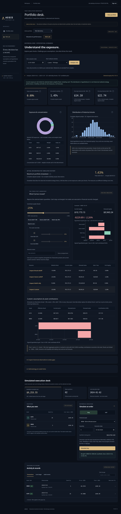
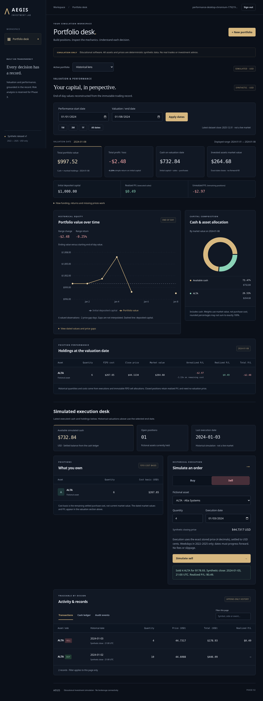

# AEGIS

**Financial Risk & Trading Analytics Platform — Phase 3**

AEGIS is an educational investment simulator built with Java 21, Spring Boot 3.5, PostgreSQL and React/TypeScript. The application combines exact decimal settlement and auditable FIFO accounting with dated portfolio valuation, simple performance returns and interactive charts.

**Simulation only.** All default assets and prices are deterministic synthetic data. No brokerage integration, real trades or investment advice. The project is not an institution-grade financial risk system.

## Implemented

Phase 1 trading/accounting and Phase 2 valuation are retained. Phase 3 adds:

- A pure historical risk engine: aligned fixed-exposure returns, sample volatility and √252 annualization, nearest-rank one-day VaR95/VaR99, and actual reconstructed portfolio maximum drawdown.
- A responsive Risk Lab with backend-driven exposure/distribution charts, explained sample requirements, weekday gaps, keyboard tooltips and explicit unavailable states.
- Read-only stress simulation: three illustrative presets, common/per-asset sliders, saved session comparisons, exact repricing and asset contributions.
- Owner-scoped risk APIs, numerical fixtures specified before code, PostgreSQL security/immutability checks and desktop/mobile browser coverage.

Phase 2 provides:

- Historical cash, quantities and FIFO cost reconstructed from immutable executions and sell allocations; future trades never leak into earlier snapshots.
- Exact-date market value, total equity, realized/unrealized/total P/L, simple return on initial capital and endpoint range performance.
- Interactive equity chart with deposited-capital baseline, mouse/keyboard tooltips, date presets/custom ranges and an accessible dated-data table.
- Cash/asset market-value allocation and marked position performance, including closed positions' realized P/L.
- Explicit missing-price/weekend gaps, no-trade and insufficient-observation states, bounded owner-scoped APIs and additive migration preserving existing portfolios.

The foundation includes:

- Registration/login with BCrypt, HttpOnly session cookies, CSRF protection and portfolio ownership checks.
- Named USD portfolios, one initial simulated cash deposit and immutable funding records.
- ALTA, BRIM and COVE: fictional assets with 3,129 fixed-seed weekday closes spanning 2022–2025.
- Historical-close buys/sells with exact decimal quantities, insufficient-cash/oversell rejection, chronological dates and portfolio-scoped idempotency.
- FIFO holdings/cost basis, realized sell P/L, transaction history, cash ledger and audit events.
- Responsive dark dashboard, record filtering/pagination, explicit loading/empty/error states and simulation labels.
- Flyway migrations, authenticated OpenAPI JSON, health checks, JSON logs, PostgreSQL integration tests and desktop/mobile browser journeys.

**Not implemented:** correlation matrices, variance attribution, benchmarks, annualized investment returns/TWR/MWR, external market data, FX or public production deployment. Annualized **volatility** is implemented. See [PROGRESS.md](PROGRESS.md).

## Run locally

Requires Docker with Compose v2. The optional helper scripts use Bash and standard Unix utilities; application components use Java and TypeScript.

```bash
./scripts/init-local.sh
# Alternatively copy .env.example to .env and choose a unique local DB password.
docker compose up --build -d
```

The UI uses local port **5173**; the API/health endpoint uses **8080**; PostgreSQL uses **5432**. Ports bind to loopback. Register your own account; no shared/demo password is built in. Confirm backend startup with:

```bash
./scripts/wait-ready.sh
# Or inspect the backend directly:
curl --fail http://localhost:8080/actuator/health
```

The first startup applies Flyway and loads synthetic data. The database lives in a named volume. `docker compose down` stops services while retaining data. Do not remove the volume unless you intentionally want to erase local accounts/portfolios. The local HTTP configuration is for development; HTTPS and `COOKIE_SECURE=true` are required before deployment. Read [ARCHITECTURE.md](ARCHITECTURE.md) for remaining security/operational work.

### Develop with local Java and Node

Requires a **full JDK 21**, Maven 3.9+, Node 24/npm and Docker for PostgreSQL/Testcontainers.

```bash
./scripts/init-local.sh
docker compose up -d --wait db
mvn -B -ntp -f backend/pom.xml verify
npm --prefix frontend ci
npm --prefix frontend run build
./scripts/start-backend.sh
# In a second terminal:
npm --prefix frontend run dev
```

`start-backend.sh` reads your trusted local `.env` and launches the packaged application. Environment variables: `DATABASE_URL` (default `jdbc:postgresql://localhost:5432/aegis`), `DATABASE_USERNAME` (default `aegis`), required `DATABASE_PASSWORD`, and `COOKIE_SECURE` (default false for local HTTP). Never commit credentials. Vite proxies `/api` to port 8080; optional `API_PROXY_TARGET` changes that development target.

In the prepared cloud workspace, use `./scripts/cloud-maven.sh -B -ntp verify` in place of `mvn`. It activates the verified full JDK/Maven, a writable cache and the existing egress proxy/system trust store without disabling TLS checks. This helper is optional and not required by standard local development or CI.

### Working performance journey

1. Register an account and create “Historical lens” with USD 1,000 of simulated capital.
2. Buy 10 ALTA at the synthetic close on 2024-01-02; sell 4 on 2024-01-03.
3. Set performance start to 2024-01-01 and valuation/end to 2024-01-08, then apply dates.
4. Inspect cash, marked holdings, realized/unrealized P/L, equity, allocation and the chart. Hover or focus the chart and use arrow keys. Expand “View dated values and price gaps” to inspect exact backend results.
5. For dataset synthetic-v1-seed-73129, this executed browser journey shows cash **$732.84**, market value **$264.68**, equity **$997.52**, realized P/L **$0.49**, unrealized P/L **−$2.97**, total P/L **−$2.48** (simple return **−0.25%** displayed). These are observed synthetic calculations, not real market results.
6. Select 2024-01-01 alone: capital is still cash and future trades are excluded. Select 2024-01-06: exact closes are missing, so total value/returns are unavailable, not zero. Return to a multi-day range for the chart.

Simulation starts at the **opening of 2022-01-03**, with the one initial deposit available then. Actual account/funding timestamps are preserved. The latest dataset date is **2025-12-31**, not wall-clock today. Period return compares two end-of-day values; since-start return compares with initial funding. Neither is TWR/MWR. Missing prices are never carried forward. The lower execution desk always shows the latest executed cash/holdings; the upper dashboard uses the selected historical date.

The separate hand-verifiable **$1,032 / 3.20%** scenario is implemented in unit/PostgreSQL tests using explicitly isolated fixture prices; it does not replace the application's synthetic market data. All formulas and limitations are in [FINANCIAL_ASSUMPTIONS.md](FINANCIAL_ASSUMPTIONS.md).

### Packaging in a restricted cloud network

Build containers may lack the cloud host's package proxy/DNS/trust configuration. A source-image build was blocked here by Maven DNS resolution. The verified alternative packages the same locally tested artifacts into nonroot runtime images:

```bash
./scripts/cloud-maven.sh -B -ntp verify
npm --prefix frontend ci
npm --prefix frontend run build
BUILDX_CONFIG=/workspace/.cache/buildx docker compose -f compose.yml -f compose.prebuilt.yml up --build -d
```

Stop local Java/Vite processes first if they occupy ports 8080/5173. This path preserves TLS verification for dependency downloads and avoids downloading dependencies inside image builds. Rebuild artifacts before repackaging after code changes. Standard local source-image builds remain available in compose.yml; their success in this restricted environment is not claimed.

### Reproduce Phase 3 risk calculations

1. Create a USD 10,000 portfolio. Buy 10 ALTA and 5 BRIM on 2024-01-02 using the execution desk.
2. Select **Risk Lab** and date **2025-12-31**, with **2 years · 730 days**. Click **Analyze risk**. The actual window is 2024-01-02–2025-12-31: 522 weekday closes / 521 aligned daily shocks. Inspect volatility, VaR95/VaR99 and the dated observation table.
3. Each shock holds the selected date’s marked exposures fixed, including cash with zero price movement. VaR sorts hypothetical USD losses and selects the nearest-rank percentile. This is not the portfolio’s realized historical strategy performance. Maximum drawdown instead uses the actual Phase 2 equity series with historical trades.
4. Set common shock to −10%, check **Override BRIM**, set BRIM to +20%, then save a named comparison. Inspect every effective shock and asset contribution. **Reset to zero** must leave equity unchanged. Presets are illustrative: broad −10%, severe −25%, relief +10%; cash is unchanged in all cases. No trades or ledger records are written.
5. Select 30 calendar days: VaR95/VaR99 are unavailable because their minimums are 100/500 daily observations. Select 2024-01-06: current risky holdings cannot be priced on that weekend, so current risk/stress are unavailable. Select 2024-01-01: future trades are excluded and the portfolio is cash-only with analytically zero market-price risk.
6. Missing weekdays invalidate affected estimates; prices are never filled or skipped silently. VaR is not maximum possible loss. Even 500 observations leave only about five observations in the 1% tail. Expand **Methodology & model limits** for conventions.

Formulas, decimal precision, limits and hand-calculated fixtures: [Phase 3 methodology](docs/PHASE3_RISK_SPEC.md). API examples: [API.md](API.md). Five new interview questions: [MENTORING.md](docs/MENTORING.md).

## Screenshots

Captured from the running application using only the fixed-seed synthetic dataset and automated browser-created simulated trades:



[Phase 3 mobile Risk Lab](docs/images/phase3-mobile.png)



[Phase 2 mobile screenshot](docs/images/phase2-mobile.png)

[Earlier Phase 1 screenshot](docs/images/phase1-desktop.png)

## Verify

```bash
mvn -B -ntp -f backend/pom.xml verify
npm --prefix frontend run build
npm --prefix frontend run format:check
npm --prefix frontend audit
# With API, database and UI running:
cd frontend
npx playwright install --with-deps chromium
npm run test:e2e
```

The backend test suite requires Docker and starts an isolated PostgreSQL database; it never silently skips database tests. E2E tests register isolated users against the running development stack. A system browser can be selected with `PLAYWRIGHT_CHROMIUM_EXECUTABLE_PATH=/usr/bin/chromium` when managed-browser downloads are unavailable. [TESTING.md](TESTING.md) records executed results and verification limits.

## Engineering guide

| Document | Content |
| --- | --- |
| [Architecture](ARCHITECTURE.md) | Modules, transaction flow, authentication, deployment boundaries |
| [Data model](DATA_MODEL.md) | Tables, relations, constraints and query-driven indexes |
| [API](API.md) | Session/CSRF flow, endpoint contracts and retry semantics |
| [Financial assumptions](FINANCIAL_ASSUMPTIONS.md) | Rounding, FIFO formulas, synthetic data, missing prices, omissions |
| [Phase 3 risk specification](docs/PHASE3_RISK_SPEC.md) | Formulas, thresholds, gaps, precision and fixtures established before implementation |
| [Security scan evidence](docs/PHASE3_SECURITY.md) | Actual dependency/secret scan scope, fixes and remaining findings |
| [Decisions](DECISIONS.md) | Important choices and alternatives |
| [Testing](TESTING.md) | Commands, evidence and scope |
| [Progress](PROGRESS.md) | Delivered and unfinished functionality |
| [Cloud environment rebuild](docs/CLOUD_ENVIRONMENT.md) | Saved Codex installation/startup instructions and state boundaries |
| [Phase plan](docs/PLAN.md) | Explicit acceptance criteria for Phases 0–5 |
| [Mentoring notes](docs/MENTORING.md) | Phase explanations and twenty interview questions with sample answers |

The repository stops after Phase 3. Phases 4–5 have not begun. The current Java advisory scan has two remaining Spring MVC advisories; see [scan scope and limitations](docs/PHASE3_SECURITY.md). This is not a production-readiness claim.
